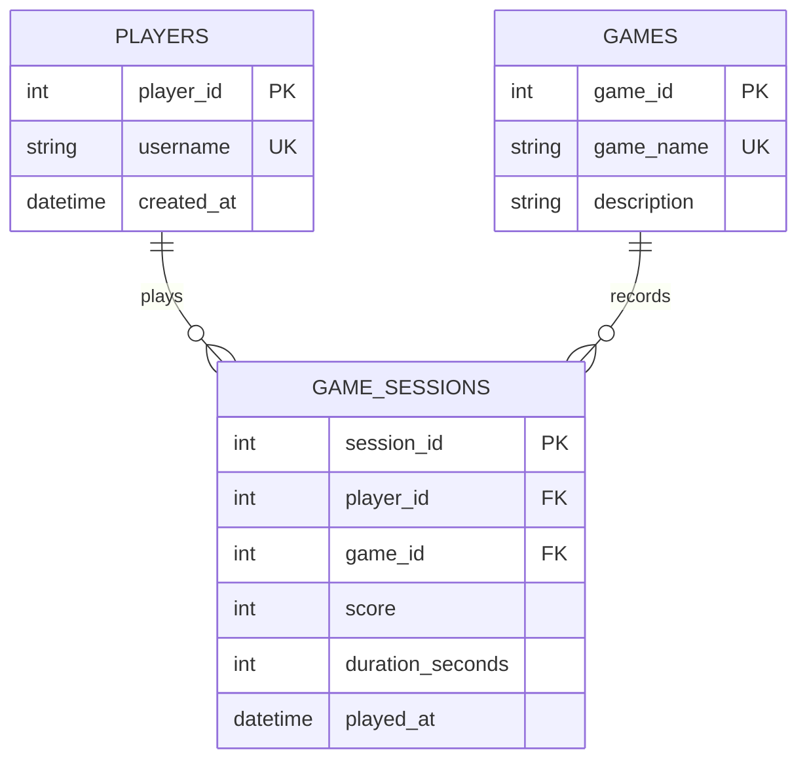

# 🕹️ Terminal Arcade Hub

A retro terminal arcade game suite and launcher built with **Node.js** and **SQLite**. Play classic games right inside your terminal — no GUI, no browser, and no heavy graphics engine required.

**GitHub Repository**: [https://github.com/Taranveer06/Termianl_Arcade_Hub](https://github.com/Taranveer06/Termianl_Arcade_Hub)  
**Problem Statement ID**: 2401020013

---

## 📖 Introduction & Problem Statement

Command-line utilities and developer environments frequently lack lightweight, engaging native breaks that preserve terminal state and require no external browser windows or heavyweight dependencies. Furthermore, typical CLI games rely on transient in-memory arrays or unindexed flat JSON files that suffer from write contention, lack referential integrity, and cannot support complex aggregations.

**Terminal Arcade Hub** solves this by engineering a professional, terminal-native arcade launcher integrated with an embedded relational database engine (**SQLite** via `better-sqlite3`). Every game session is captured with ACID guarantees, foreign key enforcement, custom check constraints, and indexed multi-table queries.

---

## 🎮 Included Games

| Game | Description | Controls |
|:---|:---|:---|
| **🐦 Flappy Bird** | Navigate through procedural pipe gaps with momentum physics and progressive difficulty | `SPACE` to flap wings, `Q` / `ESC` to quit |
| **🦕 Dino Runner** | Jump over cacti, rocks, and stones with progressive speed scaling | `SPACE` to jump, `Q` / `ESC` to quit |
| **🐍 Snake** | Classic 2D vector snake: eat food, grow longer, avoid walls and tail | `Arrow Keys` or `WASD`, `Q` / `ESC` to quit |

---

## 🚀 Key Features

- **🎮 3 Playable Games**: Flappy Bird, Dino Runner, and Snake with ANSI color graphics, collision physics, and progressive speed scaling.
- **💾 Relational Database Integration**: Persistent SQLite storage located at `data/arcade.db` as the single source of truth.
- **👤 Player Authentication & Registration**: Seamless startup prompt; creates or retrieves player accounts.
- **🏆 Global Leaderboards**: Top 5 scores per game resolved through 3-table SQL `INNER JOIN` queries with medal rankings.
- **📜 Personal Game History**: Historical record of every completed session with duration and exact timestamps.
- **📊 Comprehensive Statistics**: Aggregates games played, player averages, personal highs, and arcade-wide metrics.
- **🛡️ Data Integrity**: Foreign key enforcement (`PRAGMA foreign_keys = ON`), `CHECK(score >= 0)`, and unique constraints.
- **⚡ High Performance**: WAL journal mode (`PRAGMA journal_mode = WAL`) and precompiled prepared statements.
- **⌨️ Clean Terminal UX**: Raw mode keyboard input handling, terminal resize handling (`SIGWINCH`), and automatic cursor restoration.
- **🔄 Zero-Flicker Gameplay**: Double-box rendering, live in-game HUD showing score and personal best, and instant restart (`R`).

---

## 🛠️ Technology Stack

- **Runtime**: Node.js (v14+)
- **Language**: JavaScript (CommonJS, Strict Mode)
- **Database**: SQLite 3 (via `better-sqlite3`)
- **Interface**: ANSI Escape Sequences, VT100 Terminal Protocols
- **Testing**: Built-in Node.js Assertions Test Runner (`npm test`)

---

## 📋 System Requirements

- **Node.js**: v14.0.0 or higher
- **Terminal**: Modern terminal emulator with ANSI color and raw-mode support (macOS Terminal, iTerm2, Alacritty, GNOME Terminal, Windows Terminal)
- **Screen Dimensions**: Minimum 80 columns by 24 rows (`80×24`)

---

## 📥 Installation & Running

1. **Clone the Repository**:
   ```bash
   git clone https://github.com/Taranveer06/Termianl_Arcade_Hub.git
   cd Termianl_Arcade_Hub
   ```

2. **Install Dependencies**:
   ```bash
   npm install
   ```

3. **Launch the Arcade**:
   ```bash
   npm start
   ```
   *(Or run directly with `node src/index.js`)*

---

## 🎯 Game Controls Reference

| Context | Action | Key |
|:---|:---|:---|
| **Main Menu** | Navigate options | `↑` / `↓` Arrow keys |
| **Main Menu** | Select option | `ENTER` or numbers `1` - `7` |
| **Main Menu** | Quick Exit | `Q` or `ESC` |
| **Flappy Bird** | Flap wings | `SPACE` |
| **Flappy Bird** | Return to Menu | `Q` or `ESC` |
| **Dino Runner** | Jump over obstacle | `SPACE` |
| **Dino Runner** | Return to Menu | `Q` or `ESC` |
| **Snake** | Directional control | `Arrow Keys` or `W`, `A`, `S`, `D` |
| **Snake** | Return to Menu | `Q` or `ESC` |
| **Game Over** | Play again | `R` |
| **Game Over** | Return to Menu | `Q` or `ESC` |

---

## 🗄️ Database Architecture

The relational database file is housed at `data/arcade.db` (outside the `src/` directory and excluded from git tracking).

### Entity-Relationship Diagram



### Relational Schema

```sql
CREATE TABLE IF NOT EXISTS players (
  player_id  INTEGER PRIMARY KEY AUTOINCREMENT,
  username   TEXT    UNIQUE NOT NULL,
  created_at DATETIME DEFAULT CURRENT_TIMESTAMP
);

CREATE TABLE IF NOT EXISTS games (
  game_id     INTEGER PRIMARY KEY AUTOINCREMENT,
  game_name   TEXT    UNIQUE NOT NULL,
  description TEXT
);

CREATE TABLE IF NOT EXISTS game_sessions (
  session_id       INTEGER PRIMARY KEY AUTOINCREMENT,
  player_id        INTEGER NOT NULL REFERENCES players(player_id),
  game_id          INTEGER NOT NULL REFERENCES games(game_id),
  score            INTEGER NOT NULL CHECK(score >= 0),
  duration_seconds INTEGER,
  played_at        DATETIME DEFAULT CURRENT_TIMESTAMP
);

CREATE INDEX IF NOT EXISTS idx_sessions_player_id ON game_sessions(player_id);
CREATE INDEX IF NOT EXISTS idx_sessions_game_id   ON game_sessions(game_id);
CREATE INDEX IF NOT EXISTS idx_sessions_score     ON game_sessions(score);
CREATE INDEX IF NOT EXISTS idx_sessions_played_at ON game_sessions(played_at);
```

---

## 💡 SQL Concepts Demonstrated

1. **Table DDL & Constraints**: Primary keys, auto-incrementing surrogate keys, foreign keys, and `CHECK(score >= 0)`.
2. **Idempotent Seeding**: `INSERT OR IGNORE` safely populates catalog rows without duplication.
3. **Prepared Statements**: Parameterized queries using `better-sqlite3` prevent SQL injection.
4. **Relational Joins**: Multi-table `INNER JOIN` queries assemble leaderboards from sessions, players, and games.
5. **Aggregations**: `COUNT()`, `SUM()`, `AVG()`, `MAX()`, `ROUND()`, and `GROUP BY`.
6. **B-Tree Indexing**: Four indexes target foreign keys, score ranking, and temporal ordering.
7. **Safe Data Migration**: Automatic legacy JSON migration imports external scores idempotently into SQLite without data loss.

---

## 📁 Project Folder Structure

```
Termianl_Arcade_Hub/
├── data/
│   ├── .gitkeep
│   └── arcade.db                   # SQLite database (auto-generated)
├── docs/
│   ├── database-design.md          # Comprehensive database documentation
│   ├── ER-diagram.md               # Mermaid ER diagram specification
│   ├── sql-queries.md              # Query catalog and explanations
│   └── DEVELOPMENT_LOG.md          # Chronological development timeline
├── src/
│   ├── database/
│   │   ├── connection.js           # Database connection & WAL/FK configuration
│   │   ├── schema.sql              # Relational DDL and indexes
│   │   ├── initialize.js           # Database bootstrapper & game seeder
│   │   ├── migrateScores.js        # Safe legacy JSON to SQLite migration
│   │   ├── playerRepository.js     # Player lookup and creation
│   │   ├── gameRepository.js       # Game catalog queries
│   │   ├── sessionRepository.js    # Session persistence & leaderboard queries
│   │   └── statisticsRepository.js # Aggregations and metrics
│   ├── games/
│   │   ├── flappyBird.js           # Flappy Bird gameplay engine
│   │   ├── dinoRunner.js           # Dino Runner gameplay engine
│   │   └── snake.js                # Snake gameplay engine
│   ├── gameState.js                # Session state coordinator
│   ├── index.js                    # Application entry point & login prompt
│   ├── input.js                    # Raw-mode terminal keyboard handler
│   ├── menu.js                     # 7-option main arcade menu & screens
│   ├── renderer.js                 # ANSI graphics & canvas renderer
│   └── scores.js                   # High-score SQLite adapter & backup sync
├── tests/
│   ├── database.test.js            # Automated schema & constraints test suite
│   ├── repositories.test.js        # Repository integration test suite
│   ├── migration.test.js           # Legacy scores migration test suite
│   └── gameplay.test.js            # Physics, collisions & edge cases test suite
├── package.json
├── scores.json                     # Preserved legacy score file
└── README.md
```

---

## 🧪 Testing Instructions

An automated test suite validates the database layer, repositories, migration, and game physics using temporary test databases (preventing corruption of live player records).

Run the tests with:
```bash
npm test
```

### What is Tested:
- [x] Schema generation & table creation
- [x] Game seeding & duplicate prevention
- [x] Player registration & unique username constraint
- [x] Session persistence (including score of zero)
- [x] Negative score rejection via `CHECK` constraint
- [x] Foreign key enforcement (`player_id`, `game_id`)
- [x] Global leaderboard ranking & `LIMIT 5` capping
- [x] Player personal history with date/time
- [x] Statistical aggregations (`COUNT`, `AVG`, `MAX`)
- [x] Database persistence across connection restarts
- [x] Live repository methods and game exports
- [x] Legacy score migration & idempotency checks
- [x] Flappy Bird jump physics, gravity, and pipe collision calculations
- [x] Dino Runner jump arcs, ground landing, and obstacle collision
- [x] Snake vector movement, 180° reversal prevention, and self-collision
- [x] Input key mappings and handler cleanup

---

## 👥 Team Contributions

This project was engineered collaboratively as a group project by three core team members:

| Contributor | Role & Core Contributions | GitHub Profile |
|:---|:---|:---:|
| **Taranveer Singh** | **Project Lead & Core Architect** — Engine scaffold, ANSI canvas renderer, raw input loop, game physics & collision engine (Flappy Bird, Dino Runner, Snake), SQLite database schema DDL & WAL persistence. | [](https://github.com/Taranveer06) |
| **Shikhar Verma** | **Core Contributor** — Retro neon main arcade menu, startup coin-op authentication screen, live in-game HUDs, player rankings, interactive game instructions, and documentation. | [](https://github.com/shikharverma018) |
| **Akshat Kanwar** | **Core Contributor** — Database repositories (player, game, session, statistics), multi-table JOIN leaderboards, legacy scores.json migration module, test isolation fixtures, and automated test suites. | [](https://github.com/akshat2907-web) |

For development setup and contributing standards, see [CONTRIBUTING.md](CONTRIBUTING.md).

---

## 📜 License

This project is licensed under the MIT License.
