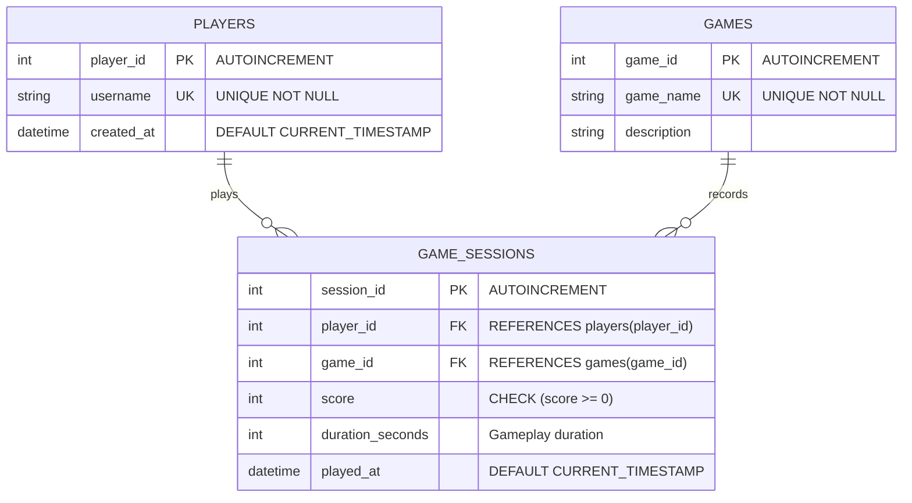

# Entity-Relationship (ER) Diagram — Terminal Arcade Hub

## Relational Entity-Relationship Diagram

### Relationship Cardinalities
1. **`PLAYERS` to `GAME_SESSIONS` (1 : N)**
   - Mandatory on the session side (`player_id` NOT NULL).
   - Optional on the player side (a newly registered player initially has 0 sessions).
2. **`GAMES` to `GAME_SESSIONS` (1 : N)**
   - Mandatory on the session side (`game_id` NOT NULL).
   - Optional on the game side (a game title can have 0 or more recorded sessions).
